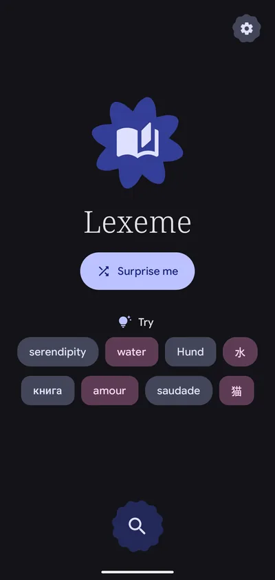
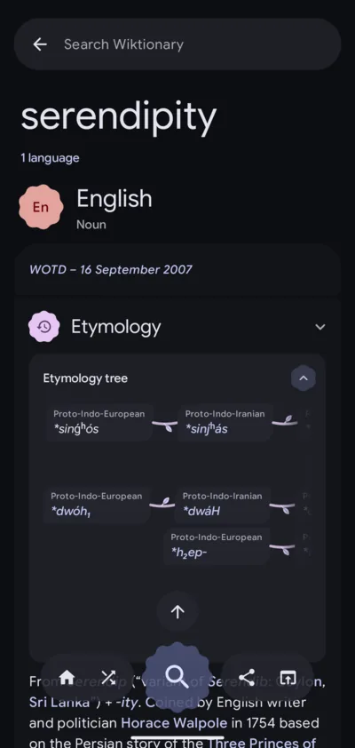
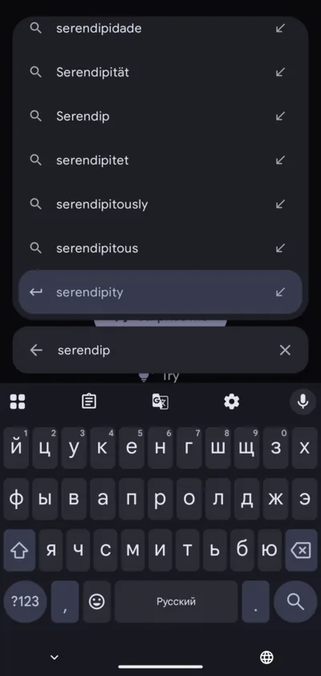
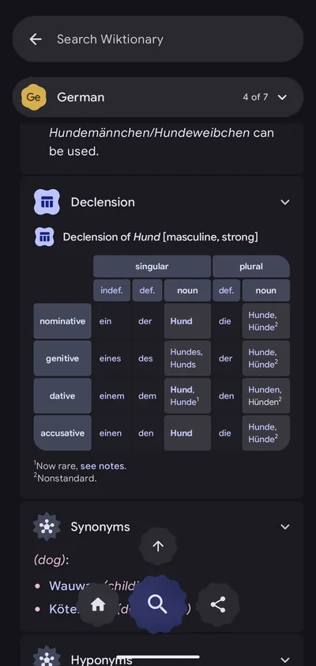
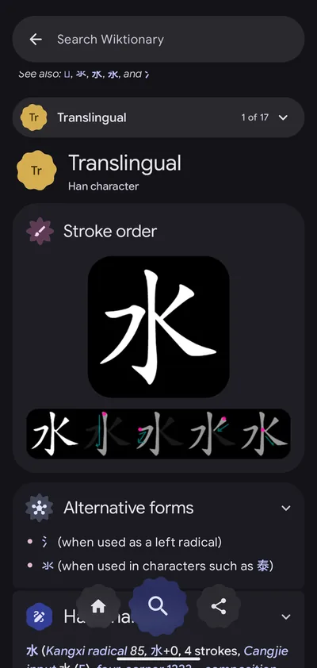
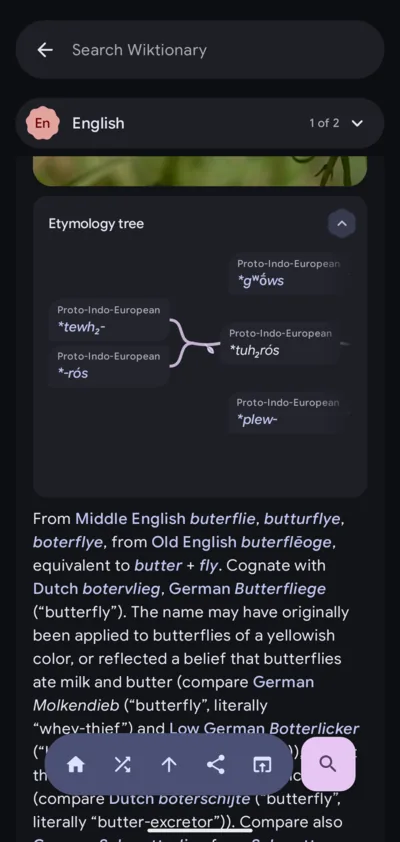
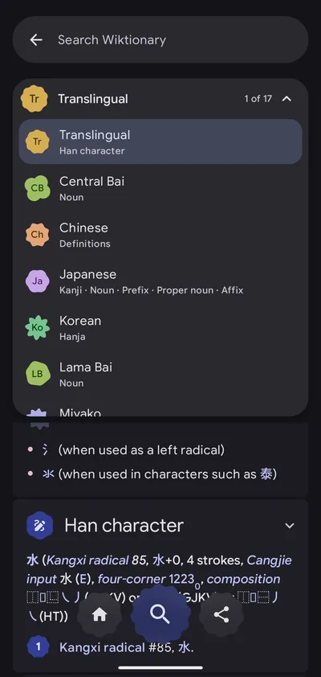
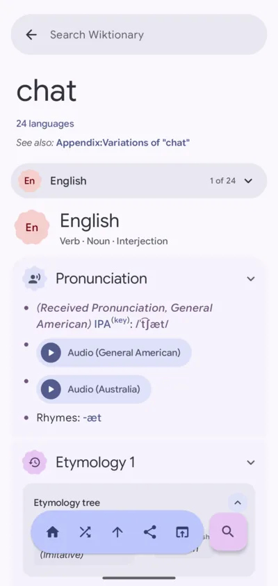
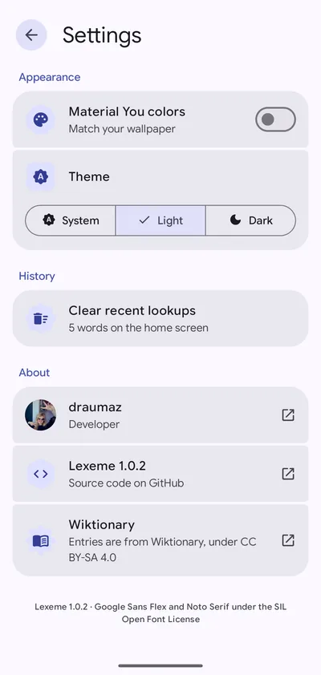
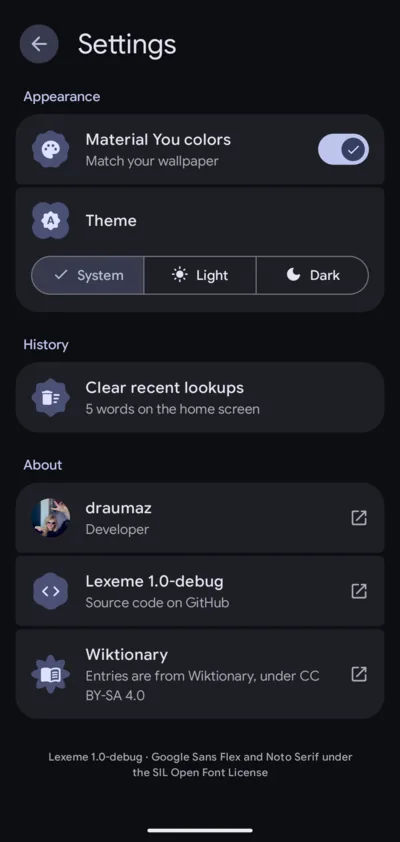

# Lexeme

An Android client for English Wiktionary, written in Kotlin with Jetpack Compose and
Material 3 Expressive. Search for a word and the app shows the full entry for every
language on the page.

<p align="center">
  
  &nbsp;
  
  &nbsp;
  
</p>

## Features

<table>
  <tr>
    <td width="300"></td>
    <td>
      <h3>Inflection tables</h3>
      Declension and conjugation tables are rendered as grids with their original row and
      column spans, header cells and footnotes. Tables wider than the screen scroll horizontally.
    </td>
  </tr>
  <tr>
    <td width="300"></td>
    <td>
      <h3>Stroke order</h3>
      Stroke-order animations and diagrams are moved into a separate card at the top of each
      language section. Black-on-transparent images are inverted in dark mode.
    </td>
  </tr>
  <tr>
    <td width="300"></td>
    <td>
      <h3>Etymology trees</h3>
      Etymology trees are laid out horizontally, oldest ancestor first. Where a word comes from
      several sources, the branches are drawn merging. Wide trees scroll horizontally.
    </td>
  </tr>
  <tr>
    <td width="300"></td>
    <td>
      <h3>Language list</h3>
      A bar pinned below the search field shows the current language and its position on the
      page. Opening it lists every language with its parts of speech; selecting one scrolls to it.
    </td>
  </tr>
</table>

Entries also include:
- numbered senses, usage examples and collapsible quotations
- audio pronunciations, IPA and images
- collapsible translation tables, and term lists shown as chips
- in-app navigation for word links, including links to a language section of another page

## Navigation

- The search field opens above the keyboard. Suggestions appear as you type, and Enter opens the
  highlighted suggestion.
- The search button sits at the bottom of every screen and expands into the search field when tapped.
  On entry pages it is flanked by home and share, with a button
  above it that jumps up one language section. These buttons hide while scrolling down and reappear when scrolling up.
- Back navigation supports the predictive back gesture and restores the previous scroll position.
- The app adds "Look up in Lexeme" to the text selection menu and opens en.wiktionary.org links.

## Settings

<p align="center">
  
  &nbsp;
  
  &nbsp;
  
</p>

- Material You (wallpaper-based) colors, on by default; when off, the app uses a fixed palette
- Theme: system, light or dark
- Clear recent lookups
- Links to the author and the source repository

## Build

```sh
./gradlew installDebug        # debug build (xyz.draumaz.lexeme.debug), installs alongside release
./gradlew assembleRelease     # minified release build, currently signed with the debug key
./gradlew testDebugUnitTest   # unit tests for the parser and table layout
```

`LEXEME_SAMPLES=/dir ./gradlew testDebugUnitTest` also parses every `<word>.html` file in `/dir`
(the `parse.text` field of an `action=parse` response) and prints an outline of the result. This
is useful for checking the parser against changes to Wiktionary's markup.

## Project structure

- `data/WiktionaryParser.kt` converts `action=parse` HTML into the document model in `data/Model.kt`.
  It handles headword lines, inflection tables, NavFrames, audio, etymology trees and stroke order
  specifically; other content is kept as text.
- `data/WiktionaryApi.kt` fetches pages (retrying with other capitalizations), search suggestions and random pages.
- `data/SettingsStore.kt` and `data/HistoryStore.kt` store settings and recent lookups in SharedPreferences.
- `ui/` contains the Compose UI: `LexemeRoot` (page stack, back handling, toolbar, search fields),
  `EntryScreen`, `HomeScreen`, `SearchBar`, `SettingsScreen`, and `ui/blocks/` with a renderer per block type.

## Credits

Content from [Wiktionary](https://en.wiktionary.org), licensed under CC BY-SA 4.0.
Fonts: [Google Sans Flex](https://fonts.google.com/specimen/Google+Sans+Flex) and
[Noto Serif](https://fonts.google.com/noto/specimen/Noto+Serif), licensed under the SIL Open Font
License (see `third_party/fonts/`).

## License

Lexeme is free software, licensed under the GNU General Public License v3.0 or later. See [LICENSE](LICENSE).
